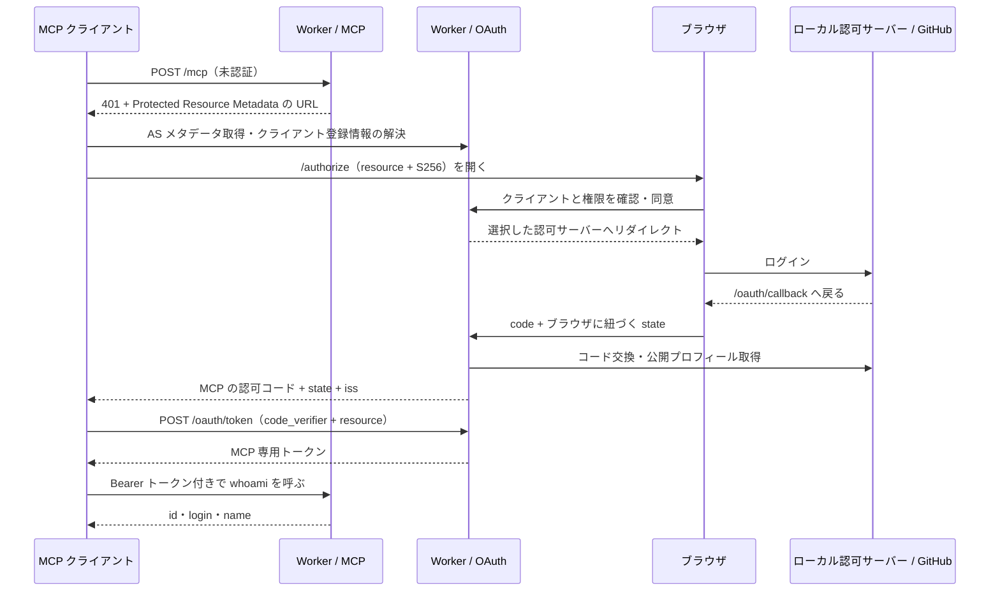

# MCP OAuth Playground

Cloudflare Workers で MCP の認証・認可を試すためのアプリです。Void / React 版と、HTTP の入口を明示した [Hono 版](hono/README.md) があり、認可と MCP のロジックを共有します。自作のローカル認可サーバー、または GitHub でユーザーを認証し、MCP 専用のアクセストークンを発行します。`whoami` ツールで、その接続を許可したユーザーのプロフィールを確認できます。

Hono 版を試す場合は `just dev-hono-local` を実行し、`http://localhost:8791/mcp` に接続します。入口は [`hono/app.ts`](hono/app.ts) です。以下は Void 版の起動・設定手順です。

2026-11-05 に [最新の公開 MCP 仕様](https://modelcontextprotocol.io/specification/latest) が **2026-07-28** に解決することを確認しています。[参考記事](https://zenn.dev/luoxi/articles/mcp-auth-oauth-from-scratch) に加え、公開済み仕様と Cloudflare 公式ライブラリの現行 API を参照しました。仕様との差分と実装の対応は [docs/authorization.md](docs/authorization.md) にあります。

## 構成

- Void / `@void/react` 1.6.1、Vite+ 1.5.0
- `@modelcontextprotocol/server` 2.4.0：MCP 2026-07-28 と従来の stateless Streamable HTTP
- `@cloudflare/workers-oauth-provider` 1.2.4：OAuth 2.1、PKCE S256、CIMD、KV による grant/token 管理
- GitHub OAuth：ログインのみ。上流トークンはプロフィール取得直後に破棄
- 自作のローカル認可サーバー：S256 検証、認可コードとトークンの発行・期限・一回使用を実装。GitHub の資格情報なしで E2E まで検証可能

単一 Worker の中で認可サーバーとリソースサーバーをモジュールに分離しています。MCP サーバーはリクエストごとに作成し、ユーザー情報を共有状態に保持しません。



## 自作の認可サーバーで試す

Node.js 24 以上、pnpm、just を使用します。

```sh
just install
just dev-local
```

GitHub OAuth App の登録や `.env` の作成は不要です。`http://localhost:5173/mcp` に MCP クライアントから接続し、同意後に表示される「Alice としてログイン」を押すと、`whoami` が次を返します。

```json
{ "id": "local-alice", "login": "alice", "name": "Local Alice" }
```

このモードは `LOGIN_PROVIDER=local` と `ENABLE_DCR=true` で起動します。検証用認可サーバーの issuer は `http://localhost:5173/local-idp` です。同じ Void Worker 内に独立した認可サーバーとして置き、`/authorize`、`/token`、`/userinfo` を公開します。認可サーバーと検証項目の詳細は [docs/local-authorization-server.md](docs/local-authorization-server.md) にあります。

ローカル認証は開発時のみ利用できます。本番ビルドには検証用サーバーを含めず、`LOGIN_PROVIDER=local` を設定してもログイン処理を拒否します。

## GitHub で試す

```sh
cp env.example .env
```

[GitHub OAuth App](https://github.com/settings/developers) を作成し、次を設定します。

- Homepage URL: `http://localhost:5173`
- Authorization callback URL: `http://localhost:5173/oauth/callback`

`.env` は `LOGIN_PROVIDER=github` にし、`GITHUB_CLIENT_ID` と `GITHUB_CLIENT_SECRET` を置き換え、`ALLOWED_GITHUB_USER_IDS` に許可する GitHub アカウントの数値 ID をカンマ区切りで設定します。ID は `gh api user --jq .id` で取得できます。ログイン名は変更・再利用されるため許可判定には使いません。旧 `ALLOWED_GITHUB_USERS` は読み込みません。GitHub モードでは未設定・空の許可リストでログインを完了できません。

```sh
just dev
```

`http://localhost:5173` に接続手順とメタデータへのリンクが表示されます。ログインは MCP クライアントから開始します。`localhost` と `127.0.0.1` は別 origin なので、起動時もクライアント登録時も上記の URL に統一してください。

GitHub の資格情報がなくても、トップページと公開メタデータは確認できます。同意後の GitHub への遷移には資格情報が必要です。

## MCP クライアントから接続

接続 URL は `http://localhost:5173/mcp` です。CIMD に対応しています。`just dev-local` では互換用の DCR も有効です。GitHub モードで DCR が必要なクライアントは `.env` を `ENABLE_DCR=true` に変更してサーバーを再起動します。通常起動の既定では DCR エンドポイントを公開しません。

1. クライアントに MCP URL を追加する。
2. ブラウザの認可画面でクライアント名・リダイレクト先・権限を確認する。
3. 選択した認可サーバーでログインする。ローカルモードでは「Alice としてログイン」を押す。
4. `whoami` を実行する。許可したアカウントの `id`、`login`、`name` が返る。

要求スコープは `mcp:read` です。更新トークンを使う場合は `offline_access` も要求します。認可リクエストとトークン取得・更新には `resource=http://localhost:5173/mcp` が必要です。

未認証時の discovery を単独で確認できます。

```sh
curl -i -X POST http://localhost:5173/mcp \
  -H 'Content-Type: application/json' -d '{}'
curl http://localhost:5173/.well-known/oauth-protected-resource/mcp
curl http://localhost:5173/.well-known/oauth-authorization-server
```

MCP 2026-07-28 の呼び出し例です。`MCP_ACCESS_TOKEN` はこの認可サーバーが発行したトークンに設定します。

```sh
curl http://localhost:5173/mcp \
  -H "Authorization: Bearer $MCP_ACCESS_TOKEN" \
  -H 'Content-Type: application/json' \
  -H 'Accept: application/json, text/event-stream' \
  -H 'MCP-Protocol-Version: 2026-07-28' \
  -H 'Mcp-Method: tools/call' \
  -H 'Mcp-Name: whoami' \
  -d '{"jsonrpc":"2.0","id":1,"method":"tools/call","params":{"name":"whoami","arguments":{},"_meta":{"io.modelcontextprotocol/protocolVersion":"2026-07-28","io.modelcontextprotocol/clientCapabilities":{}}}}'
```

`Origin` を送るブラウザクライアントは同一 origin のみ許可します。別 origin のブラウザクライアントに対応する場合は、許可リストと CORS を設計して追加してください。通常のネイティブ／サーバー側クライアントは `Origin` を送信しません。

## 認可の制限

許可リストはログイン完了時、コード交換・トークン更新時、MCP アクセス時に確認します。設定変更が反映された Worker では、許可から外したアカウントの既存アクセストークンも拒否します。拒否されたコード交換・更新は grant を失効させます。許可から外した全 grant を即時に削除する管理操作は別途必要です。

要求・発行するスコープは `mcp:read` と `offline_access` に限定し、未知のスコープは `invalid_scope` で拒否します。認可用 POST の body は実際に読み込んだバイト数で 16 KiB に制限します。トークン・同意は URL encoded form、DCR は JSON のみ受け付けます。

`void.config.ts` の `AUTH_RATE_LIMITER` は認可・callback・トークン・DCR を origin、パス、接続元 IP ごとに毎分 60 回に制限します。CIMD 取得・KV 操作・body の解析より先に適用し、超過は `429`、バインディングの欠落・障害時は `503` を返します。ローカル検証用サーバーの HTTP ルートにも適用します。接続元は Cloudflare が設定する `CF-Connecting-IP` を使い、取得できない環境は共通の匿名枠です。

[Cloudflare の仕様](https://developers.cloudflare.com/workers/runtime-apis/bindings/rate-limit/)上、この頻度制限は拠点ごとの近似カウンターです。世界全体の厳密な上限ではありません。同じ IP を使う利用者は枠を共有します。`namespace_id` は Cloudflare アカウント内の他の Worker と重複しない値に調整してください。

## 検証

別のサーバー実装にも使える [認証検証 CLI](docs/auth-audit.md) を `scripts/mcp-auth-audit.mjs` に切り出しています。HTTP 越しに今回の指摘を再検査し、操作フックがない項目は未検証として JSON に残します。`just audit-auth --help` で使い方を確認できます。

```sh
just test     # Workerd + 実 KV バインディングで OAuth/MCP のコントラクトを検証
just e2e      # Playwright / Chromium のデスクトップ・モバイル
just test-production # 本番成果物の起動・既定値・ローカル認証無効化
just check    # 型・lint・format
just build    # Cloudflare Worker の production build
```

Workers テストは、自作認可サーバーの PKCE、期限、コード再利用、同時交換、resource／redirect URI の束縛、issuer 検証を確認します。GitHub アダプターの API は回帰テストでモックします。

ブラウザテストは実際の Void dev server と自作認可サーバーを通り、MCP の `whoami`、更新、失効までモックなしで確認します。GitHub への遷移だけは外部 IdP の直前で止めます。本番成果物も Miniflare で起動し、検証用コードの除外と無効化を確認します。実 GitHub アカウントでのログインと公開環境へのデプロイは別途設定が必要です。

## Cloudflare へデプロイ

公開時は GitHub モードを使用します。`LOGIN_PROVIDER` は既定の `github` のままにします。公開時の origin を先に決め、ローカル用とは別の GitHub OAuth App に本番の callback URL を登録します。

```sh
pnpm exec void connect --platform cloudflare
pnpm exec void secret put PUBLIC_ORIGIN
pnpm exec void secret put GITHUB_CLIENT_ID
pnpm exec void secret put GITHUB_CLIENT_SECRET
pnpm exec void secret put ALLOWED_GITHUB_USER_IDS
# DCR が必要な場合のみ true を設定
pnpm exec void secret put ENABLE_DCR
just deploy
```

`PUBLIC_ORIGIN` は `https://mcp-oauth-playground.<subdomain>.workers.dev` のようなパス・末尾スラッシュなしの origin です。本番で必ず設定し、GitHub の callback を `${PUBLIC_ORIGIN}/oauth/callback` に合わせてください。Void が `OAUTH_KV` を推論して作成します。作成後の `void.lock.json` はリポジトリに保存します。`.env` はデプロイされません。

## ファイル

| パス                                | 役割                                             |
| ----------------------------------- | ------------------------------------------------ |
| `src/contracts.ts`                  | 環境・本人情報・スコープのコントラクト           |
| `src/playground.ts`                 | MCP 認可サーバー、同意、上流 callback、HTTP 境界 |
| `src/identity-provider.ts`          | ログイン先を差し替えるインターフェース           |
| `src/pkce.ts`                       | S256 とランダム値の生成                          |
| `dev/local-authorization-server.ts` | 自作の検証用認可サーバー                         |
| `dev/local-identity-provider.ts`    | 自作サーバーに接続するアダプター                 |
| `src/github.ts`                     | GitHub OAuth クライアントと許可ユーザー判定      |
| `src/mcp.ts`                        | トークン・スコープ検証と `whoami`                |
| `src/consent.ts`                    | エスケープ済み同意画面                           |
| `routes/`                           | Void の HTTP ルート                              |
| `pages/`                            | 接続案内の React Pages                           |
| `tests/` / `e2e/`                   | Workers コントラクトテスト / ブラウザテスト      |
