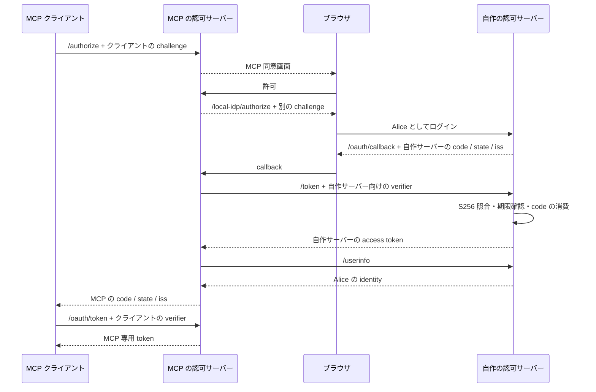

# 自作の認可サーバーで PKCE を検証する

```sh
just install
just dev-local
```

`http://localhost:5173/mcp` に MCP クライアントを接続します。MCP の同意画面からローカル認可サーバーに進み、「Alice としてログイン」を押します。GitHub には接続しません。固定の検証ユーザーは `{ id: "local-alice", login: "alice", name: "Local Alice" }` です。

## 構成

同じ Void Worker 内に、異なる issuer の認可サーバーを二つ置いています。

| 役割                     | issuer                            | 実装                                |
| ------------------------ | --------------------------------- | ----------------------------------- |
| MCP 向けの認可サーバー   | `http://localhost:5173`           | Cloudflare OAuth Provider           |
| 自作の検証用認可サーバー | `http://localhost:5173/local-idp` | `dev/local-authorization-server.ts` |

外側の MCP 認可フローはそのままにし、従来 GitHub に任せていたログインを、自作の OAuth 認可サーバーに差し替えます。両方のフローに別々の verifier、challenge、code、state、token があります。



ブラウザは実際の HTTP エンドポイントにアクセスします。Worker 内のバックチャネルは、HTTP ルートと同じ `Request → Response` ハンドラーを直接呼び出します。`fetch` のモックや成功レスポンスの固定返却は使わず、自作コードによる検証・発行を通します。別プロセスへの HTTP 通信はこの構成の対象外です。

## エンドポイント

| パス                                                    | 動作                                                                                |
| ------------------------------------------------------- | ----------------------------------------------------------------------------------- |
| `GET /.well-known/oauth-authorization-server/local-idp` | issuer、S256、認可／トークン URL を広告                                             |
| `GET /local-idp/authorize`                              | 登録済み client、redirect、resource、challenge を検証し、ログイン画面を表示         |
| `POST /local-idp/authorize`                             | Cookie・Origin に紐づく操作を確認し、同意ならコードを発行、拒否なら `access_denied` |
| `POST /local-idp/token`                                 | `code_verifier` を検証して、自作の短命トークンを発行                                |
| `GET /local-idp/userinfo`                               | このサーバーが発行した有効な Bearer token でのみ identity を返す                    |

事前登録する client ID は `playground-local`、redirect URI は `http://localhost:5173/oauth/callback`、resource は `http://localhost:5173/local-idp/userinfo`、scope は `profile` です。公開クライアントとして PKCE でコードを保護するため、この検証用サーバーとの通信に client secret は使いません。

## 検証の中心

[RFC 7636](https://www.rfc-editor.org/rfc/rfc7636) に沿って `BASE64URL(SHA256(code_verifier))` と保存済み challenge を比較します。verifier は 43〜128 文字で、許可された文字のみ受け付けます。`plain` は拒否します。RFC の既知ベクトルでもハッシュ計算を検証しています。

認可コードは 60 秒、アクセストークンは 300 秒で失効します。コードを client ID・redirect URI・resource に束縛し、交換時にはハッシュ計算の `await` より前にコードを消費します。間違った verifier を試した後の再交換や同時交換も拒否します。

上流 callback の `iss` は記録した issuer と完全一致させ、不一致や欠落を検出したらコードを交換しません。同意用の handle は Cookie と Origin に紐づけ、再利用できません。

## テスト

```sh
just test
just e2e
just test-production
```

- `tests/local-authorization-server.test.ts`：S256 既知ベクトル、metadata、正しい交換、verifier の欠落・不一致・形式、同時交換、期限、client／redirect／resource の束縛、同意偽造・拒否
- `tests/local-provider.test.ts`：issuer の不一致・欠落では上流コードを交換しない
- `e2e/local-flow.spec.ts`：ブラウザログインから MCP 呼び出し・更新・失効までの完走と、HTTP での不正 verifier の拒否
- `scripts/check-production.mjs`：実際の本番成果物でローカル認証の除外・拒否、環境変数の既定値を検証

## 開発用サーバーの範囲

固定ユーザーを選ぶログイン画面で、本人確認の機構はありません。PKCE のプロトコル検証を目的としています。状態は各 1024 件を上限とするプロセス内 Map に置き、再起動で失われます。複数 isolate での運用や永続化には対応していません。

ルートは Void の `.dev.ts` で開発時だけ登録し、アダプターも `import.meta.env.DEV` の内側で読み込みます。本番では検証用コードを含めず、`LOGIN_PROVIDER=local` を明示しても 503 で拒否します。通常の `just dev` は GitHub モードで、ローカル認可サーバーの URL は 404 です。

検証用サーバーが実装する grant は authorization code のみです。MCP 接続の refresh token と失効は外側の MCP 認可サーバーが担当します。
